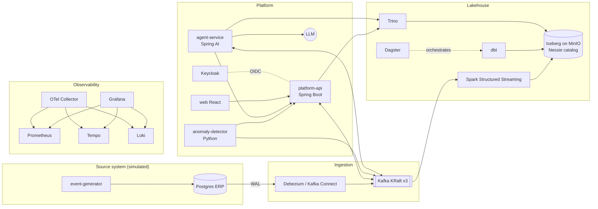

# KPI Sentinel

> An AI agent that finds out **why** a business KPI moved, built on a real-time data platform: CDC → Kafka → Iceberg → dbt → semantic layer → agent.

KPI Sentinel monitors the sales KPIs of a fictional FMCG distributor (Atlas Distribution, Morocco), detects anomalies and launches a root cause analysis agent that explains the deviation, with evidence.

## Architecture



Simulated ERP (Postgres) → Debezium → Kafka (KRaft, 3 nodes) → Spark Structured Streaming → Iceberg (MinIO, Nessie) → dbt on Trino → semantic layer (YAML + `libs/semantic-core`) → `platform-api` (Spring Boot) ⇄ `anomaly-detector` (Python) ⇄ `agent-service` (Spring AI) → React interface. Details, ports and contracts: [docs/02-architecture.md](docs/02-architecture.md).

## Status

Under active development.

| Milestone | Content | State |
|---|---|---|
| M1 | Foundations, simulated ERP, Debezium + Kafka CDC | In progress |
| M2 | Iceberg lakehouse, dbt, semantic layer | Planned |
| M3 | platform-api, Keycloak, anomaly detection | Planned |
| M4 | Root cause analysis agent | Planned |
| M5 | Evaluation, benchmark, web interface, demo | Planned |

## Documentation

| Document | Content |
|---|---|
| [docs/01-product-vision.md](docs/01-product-vision.md) | Problem, users, goals, scope |
| [docs/02-architecture.md](docs/02-architecture.md) | Components, flows, contracts, SLOs, layout, versions |
| [docs/03-engineering-standards.md](docs/03-engineering-standards.md) | Git, pull requests, tests, conventions |
| [docs/04-prerequisites.md](docs/04-prerequisites.md) | Machine, software, accounts |
| [docs/adr/](docs/adr/) | Architecture decision records |

## Getting started

Prerequisites: JDK 21, Python 3.12 and [uv](https://docs.astral.sh/uv/), GNU make, Docker. Maven is provided by the wrapper.

```bash
./mvnw -q validate   # Java build: checks the JDK and Maven versions
uv sync              # creates .venv with the shared Python tooling
make help            # lists the targets
make lint            # Spotless, ruff, sqlfluff, ESLint
make test            # Maven verify, pytest, web tests
make fmt             # reformats Java and Python
```

## Contributing

Branches follow `<type>/<short-description>`, commits follow [Conventional Commits](https://www.conventionalcommits.org/), and every change goes through a pull request with `make lint` and `make test` passing. See [docs/03-engineering-standards.md](docs/03-engineering-standards.md).

## License

[MIT](LICENSE).
