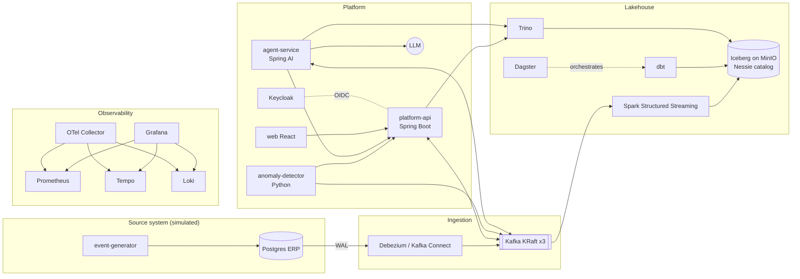
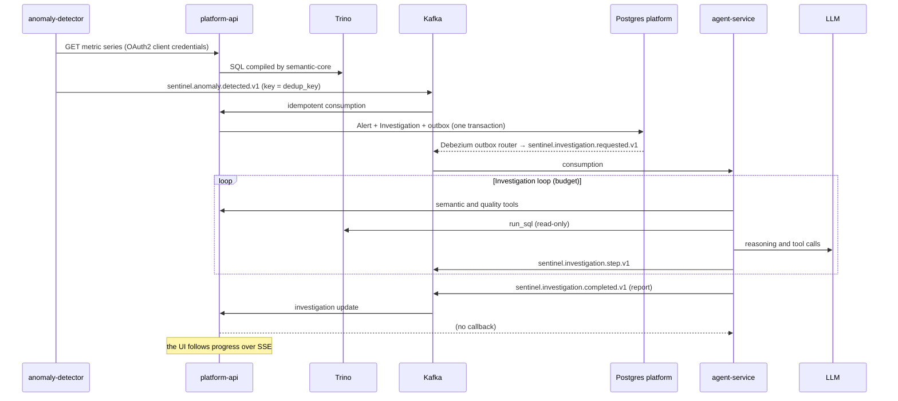
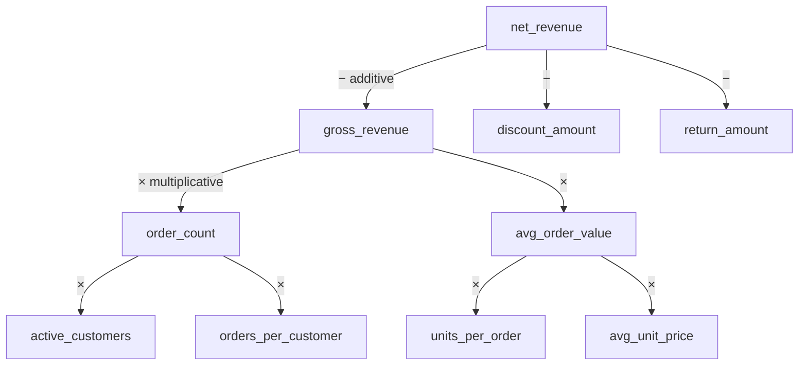

# Architecture — KPI Sentinel

This document is the technical reference. Any change that adds or modifies a component updates the relevant section in the same PR.

## 1. Overview



Principles:

- **The log is the source of truth**: every ERP change goes through the WAL, Debezium and Kafka. Nobody reads the production database for analytics.
- **A single definition of metrics**: the semantic layer (`semantic/`) is used by the API, the detector and the agent.
- **Asynchronous communication between services** through CloudEvents; synchronous HTTP for reads only.
- **The agent is constrained**: typed tools, read-only SQL, budgets, mandatory evidence.

## 2. Containers

| Component | Technology | Role | Local port | Profile |
|---|---|---|---|---|
| postgres-source | PostgreSQL | Simulated ERP (`erp` schema), `wal_level=logical` | 5432 | core |
| flyway-source | Flyway | ERP migrations | — | core |
| event-generator | Python | Reference data, history, live stream, scenarios | 8094 | core |
| kafka-1, kafka-2, kafka-3 | Apache Kafka (KRaft) | Event log, RF = 3 | 9092 / 9094 / 9096 | core |
| kafka-ui | Kafbat UI | Topic inspection | 8080 | core |
| kafka-connect | Debezium Connect | ERP CDC and platform outbox | 8083 | core |
| postgres-platform | PostgreSQL | `platform`, `keycloak`, `nessie`, `dagster` databases | 5433 | core |
| minio | MinIO | S3-compatible object storage | 9000 / 9001 | lake |
| nessie | Project Nessie | Versioned Iceberg catalog | 19120 | lake |
| trino | Trino | Distributed SQL engine | 8088 | lake |
| spark-streaming | Spark + Iceberg | Bronze, silver and maintenance jobs | 4040 | lake |
| dagster | Dagster | Orchestration of dbt, maintenance, detection | 3000 | lake |
| keycloak | Keycloak | OIDC, roles, tenants | 8180 | platform |
| platform-api | Spring Boot | API, semantics, alerts, investigations, outbox | 8090 | platform |
| anomaly-detector | Python, FastAPI | STL + robust z-score detection | 8092 | platform |
| agent-service | Spring Boot, Spring AI | Root cause analysis agent | 8091 | platform |
| web | React, Vite, TypeScript | User interface | 5173 | platform |
| mailpit | Mailpit | Development email | 8025 | platform |
| otel-collector, prometheus, grafana, tempo, loki | Observability | Traces, metrics, logs | 4317-4318, 9090, 3001, 3200, 3100 | obs |

## 3. Main flows

### 3.1 Ingestion

1. The generator writes to `postgres-source` (realistic transactions).
2. Debezium reads the WAL through the `sentinel_pub` publication and the `sentinel_slot` slot, and publishes one event per changed row to `atlas.erp.<table>`.
3. The **bronze** job writes raw events to `bronze.cdc_events` with their Kafka coordinates (topic, partition, offset).
4. The **silver** job applies changes with `MERGE` (latest LSN wins) into current-state tables, and feeds the status history.

### 3.2 Transformation

Dagster runs `dbt build` every hour: staging → intermediate → marts (`fct_`, `dim_`) → gold aggregates (`agg_`). Test results are loaded into `quality.dq_results`, which the agent uses.

### 3.3 Detection and investigation



## 4. Data

### Layers

| Layer | Location | Content |
|---|---|---|
| Source | `postgres-source`, `erp` schema | ERP: reference data, orders, deliveries, returns, stock, prices, promotions |
| Bronze | `lakehouse.bronze` | `cdc_events` (raw Debezium envelope), `quarantine` |
| Silver | `lakehouse.silver` | Current-state tables (ERP mirror), `order_status_events`, real-time aggregates |
| Staging / intermediate | `lakehouse.staging`, `lakehouse.intermediate` | dbt models `stg_`, `int_` |
| Gold | `lakehouse.gold` | `fct_order_lines`, `fct_deliveries`, `fct_returns`, `dim_*`, `agg_sales_daily`, `agg_service_daily` |
| Quality | `lakehouse.quality` | `dq_results`, `late_events` |

### Gold aggregate tables

- `agg_sales_daily` — grain: date × city × channel × category × brand × sales rep × warehouse. Additive measures: `gross_revenue`, `discount_amount`, `return_amount`, `net_revenue`, `order_lines`, `units`. Non-additive measures stored as HyperLogLog sketches: `orders_hll`, `customers_hll`.
- `agg_service_daily` — grain: date × city × warehouse × channel. Measures: `ordered_units`, `delivered_units`, `deliveries`, `on_time_deliveries`, `cancelled_orders`.

## 5. Semantic layer

Metrics are defined in YAML in `semantic/metrics/`, validated by `semantic/schema/metric.schema.json`, and compiled to Trino SQL by `libs/semantic-core`.



Example:

```yaml
# semantic/metrics/gross_revenue.yaml
name: gross_revenue
label: Gross revenue
description: Gross amount of non-cancelled order lines.
owner: sales-leadership
type: base
base:
  table: gold.agg_sales_daily
  measure: sum(gross_revenue)
  time_column: order_date
unit: MAD
good_direction: up
dimensions: [region, city, channel, category, brand, sales_rep, warehouse]
time_grains: [day, week, month]
decomposition:
  method: multiplicative
  children: [order_count, avg_order_value]
alerting:
  min_volume: 50000
```

Key rules: a ratio is computed as `sum(numerator) / sum(denominator)`, never as an average of ratios; distinct counts are merged through HyperLogLog; filter values are passed as bound parameters, never concatenated.

## 6. Contracts

### Domain events

**CloudEvents 1.0** format (JSON), with the `tenantid` and `traceparent` extensions. JSON Schema of the `data` field in `contracts/events/<type>.json`. Only backward-compatible changes are allowed within a version; otherwise, a new `.v2` version and a dual-publishing period.

```json
{
  "specversion": "1.0",
  "id": "7f1c2a9e-0d4b-4c3f-9a51-1f0e8f4b2c11",
  "source": "/services/platform-api",
  "type": "sentinel.investigation.requested.v1",
  "time": "2026-11-14T10:15:00Z",
  "datacontenttype": "application/json",
  "tenantid": "atlas",
  "traceparent": "00-4bf92f3577b34da6a3ce929d0e0e4736-00f067aa0ba902b7-01",
  "data": { "investigationId": "…", "metric": "net_revenue", "window": { "start": "2026-11-03", "end": "2026-11-09" }, "scope": { "region": "Casablanca-Settat" } }
}
```

### Kafka topics

| Topic | Producer | Consumers | Key | Partitions | Retention |
|---|---|---|---|---|---|
| `atlas.erp.orders`, `order_lines`, `deliveries`, `returns`, `inventory` | Debezium | Spark bronze | PK (lines re-keyed by `order_id`) | 12 | 7 days |
| `atlas.erp.<reference-table>` | Debezium | Spark bronze | PK | 3 | compacted |
| `sentinel.anomaly.detected.v1` | anomaly-detector | platform-api | `dedup_key` | 6 | 14 days |
| `sentinel.investigation.requested.v1` | platform-api outbox | agent-service | `investigation_id` | 6 | 14 days |
| `sentinel.investigation.step.v1` | agent-service | platform-api | `investigation_id` | 6 | 7 days |
| `sentinel.investigation.completed.v1` | agent-service | platform-api | `investigation_id` | 6 | 30 days |
| `<topic>-retry-N`, `<topic>-dlt` | Spring Kafka | operations | same | same | 14 days |

### REST API (platform-api)

`/api/v1` prefix, JSON, `application/problem+json` errors (RFC 9457), cursor pagination, `Idempotency-Key` header accepted on `POST` requests that create resources. Specification exported to `contracts/openapi/platform-api.yaml`.

| Resource | Main endpoints |
|---|---|
| Metrics | `GET /metrics`, `GET /metrics/{name}`, `GET /metrics/{name}/tree`, `POST /metrics/query`, `POST /metrics/{name}/decompose`, `POST /metrics/{name}/contributions` |
| Alerts | `GET /alerts`, `GET /alerts/{id}`, `POST /alerts/{id}/acknowledge`, `POST /alerts/{id}/resolve` |
| Investigations | `POST /investigations`, `GET /investigations`, `GET /investigations/{id}`, `GET /investigations/{id}/steps`, `GET /investigations/{id}/stream` (SSE), `POST /investigations/{id}/cancel` |
| Quality | `GET /quality/freshness`, `GET /quality/results` |

## 7. Non-functional requirements and SLOs

| Area | Target |
|---|---|
| CDC lag (WAL → Kafka) | p95 < 10 s, alert if > 5 min |
| Silver freshness | < 5 min in live mode |
| Gold freshness | < 60 min, 99 % of the time |
| Investigation | p95 < 120 s, success rate ≥ 95 % |
| API | 99.5 % availability (measured locally), p95 < 500 ms excluding analytical queries |
| Data loss | none with one Kafka node down |
| Cost | LLM cost recorded per investigation, daily cap per tenant |

## 8. Security

- OIDC authentication (Keycloak), roles `ADMIN`, `ANALYST`, `VIEWER`, `SERVICE`; `tenant_id` claim.
- Service to service: OAuth2 client credentials.
- The agent queries Trino with a read-only user limited to the `gold` schema and `quality.dq_results`; SQL is validated before execution.
- Tool outputs are treated as data, never as instructions (defense against prompt injection).
- Secrets only in `.env` (not committed); gitleaks scan in pre-commit and in CI.
- Threat model: `docs/design/rca-agent.md` (agent) and `docs/security/threat-model.md` (platform).

## 9. Distributed systems concepts

| Concept | Where in the project |
|---|---|
| CDC, the log as source of truth | Debezium reads the WAL |
| Replication and ISR | Kafka RF = 3, `min.insync.replicas=2`, `acks=all` |
| Raft consensus | Kafka KRaft controllers |
| Partitioning and ordering | `order_id` key, Debezium partition routing |
| Log compaction | Reference data topics |
| At-least-once and idempotency | `MERGE` by LSN, `processed_events` table, `dedup_key`, idempotent producer |
| Effectively exactly-once | Spark checkpoints and Iceberg commits |
| Event time, watermarks, late data | Spark windows |
| Transactions on object storage, optimistic concurrency | Iceberg commits |
| Dual write and transactional outbox | platform-api |
| Retries, backoff, dead letter | Spring Kafka, bronze quarantine |
| Circuit breaker, bulkhead, rate limiting | Resilience4j, Bucket4j |
| Caching and version-based invalidation | Semantic cache keyed by Iceberg snapshot |
| Mergeable probabilistic sketches | HyperLogLog for distinct counts |
| Optimistic locking | `@Version` on Investigation |
| Distributed tracing | `traceparent` over HTTP and in Kafka headers |
| Back-pressure | `maxOffsetsPerTrigger`, bounded agent concurrency |
| Demonstrated fault tolerance | Chaos experiments |
| Horizontal scalability | Consumer groups, KEDA autoscaling |

## 10. Environment profiles

| Profile | Content | RAM |
|---|---|---|
| `core` | 2 Postgres, 3 Kafka, Connect, Kafka UI, generator | ~5 GB estimated; the 2 Postgres alone use ~70 MB idle (measured) |
| `lake` | MinIO, Nessie, Trino, Spark, Dagster | ~6 GB |
| `platform` | Keycloak, platform-api, agent-service, anomaly-detector, web | ~3 GB |
| `obs` | OTel Collector, Prometheus, Grafana, Tempo, Loki | ~1.5 GB |

Profiles can be combined: `make up PROFILE="core lake"`. Every service also belongs to the `all` profile. Ports are bound to `127.0.0.1` and can be changed in `infra/compose/.env`; each service has a memory limit. Operations: [docs/runbooks/local-environment.md](runbooks/local-environment.md).

## 11. Repository layout

```
kpi-sentinel/
├── README.md
├── Makefile
├── pom.xml                   # Maven parent of the Java modules
├── pyproject.toml            # uv workspace of the Python packages
├── .github/                  # CI, issue and PR templates, CODEOWNERS
├── contracts/
│   ├── events/               # JSON Schemas of the CloudEvents
│   ├── openapi/              # exported OpenAPI specifications
│   └── reports/              # investigation report schema
├── semantic/
│   ├── metrics/              # one metric per YAML file
│   ├── dimensions.yaml
│   ├── calendar/             # shared Moroccan calendar
│   └── schema/               # validation JSON Schema
├── infra/
│   ├── compose/              # docker-compose.yml, .env.example
│   ├── postgres/  kafka/  connect/  minio/  nessie/  trino/  keycloak/
│   └── observability/        # collector, prometheus, grafana, tempo, loki
├── libs/
│   ├── semantic-core/        # Java: model, SQL compiler, decomposition
│   └── events-java/          # Java: CloudEvents envelope, idempotent consumer
├── services/
│   ├── event-generator/      # Python
│   ├── platform-api/         # Java, Spring Boot
│   ├── agent-service/        # Java, Spring Boot, Spring AI
│   ├── anomaly-detector/     # Python, FastAPI
│   └── web/                  # React, Vite, TypeScript
├── pipelines/
│   ├── streaming/            # PySpark: bronze, silver, maintenance
│   ├── dbt/                  # dbt-trino project
│   └── orchestration/        # Dagster
├── evaluation/               # scenarios, ground truth, harness, baselines, results
└── docs/                     # vision, architecture, ADRs, design docs, runbooks
```

## 12. Pinned versions

Each row gives the verification date and what compatibility was checked.

| Component | Version | Verified on | Compatibility checked with |
|---|---|---|---|
| Java (JDK) | 21 (Temurin) | 2026-11-14 | Spring Boot 3.5 (17 to 25), enforced by Enforcer `[21,)` |
| Maven / Maven Wrapper | 3.9.16 / 3.3.4 | 2026-11-14 | Maven Central; Enforcer requires `[3.9.9,)` |
| Spring Boot (BOM) | 3.5.16 | 2026-11-14 | Latest 3.x line, as required by ADR-0007 |
| Spotless / google-java-format | 3.11.0 / 1.37.0 | 2026-11-14 | JDK 21 |
| JaCoCo | 0.8.16 | 2026-11-14 | JDK 21 |
| Surefire / Failsafe / Enforcer / Compiler | 3.6.1 / 3.6.1 / 3.7.0 / 3.16.0 | 2026-11-14 | Maven 3.9 |
| Python / uv | 3.12 / 0.13 | 2026-11-14 | Package versions pinned in `uv.lock` |
| PostgreSQL (image `postgres:18.7-bookworm`) | 18.7 | 2026-11-25 | Latest 18.x; 19.0 is a fresh major, kept back until Debezium support is confirmed |
