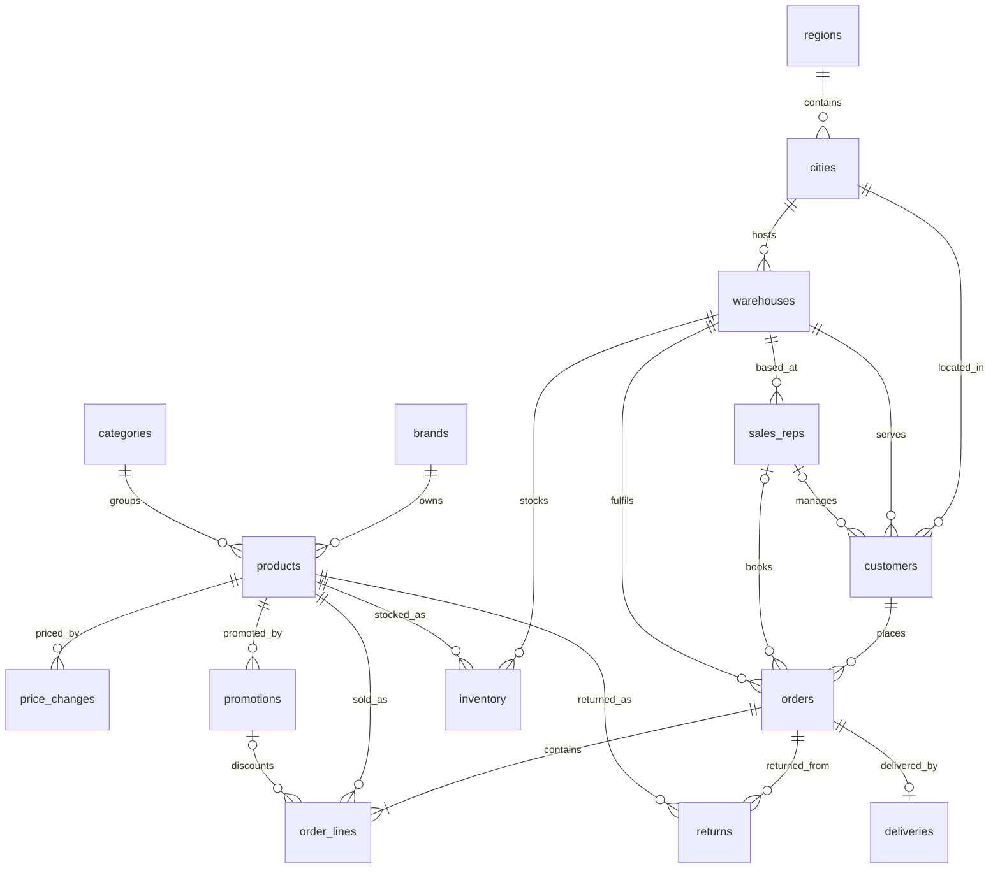

# Data model — simulated ERP (`erp` schema)

The source system of Atlas Distribution, a fictional FMCG distributor in Morocco. It lives in the `atlas` database of `postgres-source`; Flyway applies the migrations in `infra/postgres/source/migrations/`, and keeps its history in a separate `flyway` schema.

Conventions:

- Reference data uses `bigint` identity keys; orders use `uuid` keys.
- Amounts are `numeric(12, 2)` in Moroccan dirhams (MAD); timestamps are `timestamptz` stored in UTC.
- Every table has `created_at` and `updated_at`; a `BEFORE UPDATE` trigger (`erp.set_updated_at`) keeps `updated_at` current.
- Every foreign key and every date used for filtering is indexed.
- Table-level checks have explicit names, so a violation is self-explanatory.

## Entity-relationship diagram

## Data dictionary

### Reference data

| Table | Grain | Key columns and rules |
|---|---|---|
| `regions` | One administrative region of Morocco | `code` and `name` unique |
| `cities` | One city | `region_id`; `name` unique within a region |
| `warehouses` | One distribution warehouse | `code` unique, `city_id` |
| `sales_reps` | One sales representative | `code` unique, `warehouse_id`, `hired_on`, `left_on` (null while employed, never before `hired_on`) |
| `customers` | One point of sale | `channel` ∈ `TRADITIONAL`, `MODERN_TRADE`, `HORECA`, `ECOMMERCE`; `city_id`, `warehouse_id`; `sales_rep_id` (null when the portfolio is unassigned); `opened_on`, `closed_on` |
| `brands` | One brand | `name` unique |
| `categories` | One product category | `name` unique |
| `products` | One SKU | `sku` unique, `brand_id`, `category_id`, `pack_size`, current `list_price` ≥ 0, `is_active` |
| `price_changes` | One list price change | `product_id`, `effective_from` (unique together), `list_price` ≥ 0. The price in effect on a date is the latest row with `effective_from` ≤ that date |
| `promotions` | One promotion on a product | `product_id`, optional `channel`, `starts_on` ≤ `ends_on`, `discount_pct` in ]0, 100] |

### Transactions

| Table | Grain | Key columns and rules |
|---|---|---|
| `orders` | One customer order | `id` (uuid), `customer_id`, `sales_rep_id`, `warehouse_id`, `channel`; `status` ∈ `PLACED`, `CONFIRMED`, `SHIPPED`, `DELIVERED`, `CANCELLED`, with the timestamp of each step; a cancelled or delivered order must carry the matching timestamp |
| `order_lines` | One product in an order | `order_id`, `line_number` (unique together), `product_id`, optional `promotion_id`; `quantity` > 0, `unit_price` ≥ 0, `gross_amount` = `quantity` × `unit_price`, 0 ≤ `discount_amount` ≤ `gross_amount`. Net amount = `gross_amount` − `discount_amount` |
| `deliveries` | The delivery of one order | `order_id` unique, `warehouse_id`, `promised_on`, `status` ∈ `SCHEDULED`, `IN_TRANSIT`, `DELIVERED`, `FAILED`, `shipped_at`, `delivered_at`, `delivered_units` ≥ 0. On time when delivered on or before `promised_on` |
| `returns` | One returned product of an order | `order_id`, `product_id`, `quantity` > 0, `amount` ≥ 0, `reason` ∈ `DAMAGED`, `EXPIRED`, `WRONG_ITEM`, `CUSTOMER_REFUSAL`, `OTHER`, `returned_at` |
| `inventory` | Current stock of a product in a warehouse | Primary key (`warehouse_id`, `product_id`), `quantity_on_hand` ≥ 0, `reorder_point` ≥ 0. Every stock movement is an `UPDATE` of this row |

## Change data capture

- **Publication** `sentinel_pub` lists the 15 tables explicitly: a new table is only captured once it is added on purpose.
- **Replica identity**: `orders` and `inventory` use `REPLICA IDENTITY FULL`, so an update event carries the full previous row (status transitions, stock before and after). The other tables send only their primary key as the previous image.
- **Role** `debezium`: `LOGIN` and `REPLICATION`, `SELECT` on the `erp` tables, no write privilege.
- `gross_amount` is a stored column rather than a generated one, because generated columns are not published by default.
